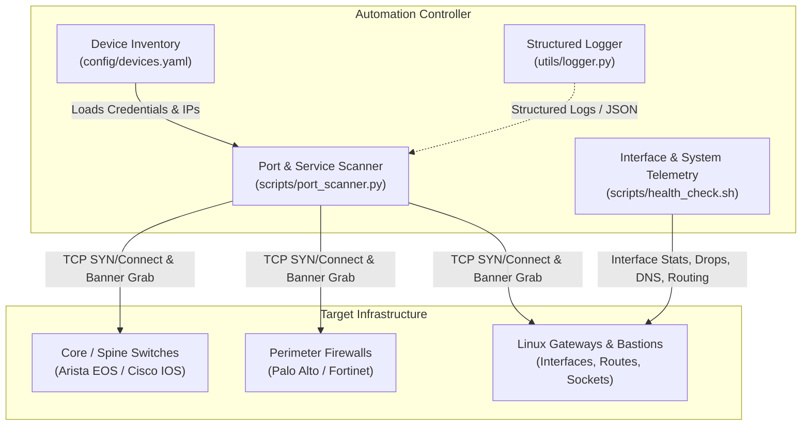

# Systems & Network Infrastructure Automation (`net-infra-automation`)

[](https://www.python.org/)
[](https://www.paramiko.org/)
[](https://pyyaml.org/)
[](LICENSE)

A modular, production-ready framework for network engineers and systems administrators. Provides declarative device inventory management, multi-threaded port and service scanning, system and interface telemetry probes, and structured operational logging.

---

## Architecture Overview



### Key Pillars

1. **Declarative Device Inventory**:
   - `config/devices.yaml` serves as the single source of truth for topology grouping, connection timeouts, authentication mechanisms (SSH keys, environment variable references), and device metadata.
2. **High-Throughput Network Discovery**:
   - `scripts/port_scanner.py` utilizes worker thread pools to asynchronously probe TCP endpoints, identify services, and grab protocol banners without third-party external binaries.
3. **Low-Overhead Telemetry**:
   - `scripts/health_check.sh` gathers native Linux networking statistics, default gateway latency, DNS resolution health, interface packet drops, and socket utilization.
4. **Structured Logging**:
   - `utils/logger.py` formats execution traces with colorized ANSI output for interactive terminals and structured single-line JSON for log aggregators (Elasticsearch, Datadog, Loki).

---

## Directory Structure

```text
net-infra-automation/
├── README.md                      # Architecture documentation and operational runbooks
├── requirements.txt               # Python library dependencies (Paramiko, PyYAML, Requests)
├── .gitignore                     # Git ignore rules for virtual environments and secrets
├── config/
│   └── devices.yaml               # Declarative device inventory and credentials spec
├── utils/
│   ├── __init__.py                # Utilities package initialization
│   └── logger.py                  # Dual-mode (Color/JSON) structured logging library
└── scripts/
    ├── health_check.sh            # Network interface and OS telemetry probe
    └── port_scanner.py            # Multi-threaded TCP port and service scanner
```

---

## Installation & Setup

### 1. Create Virtual Environment

```bash
cd net-infra-automation
python3 -m venv .venv
source .venv/bin/activate
```

### 2. Install Dependencies

```bash
pip install -r requirements.txt
```

---

## Automation Workflows & Usage

### 1. Network Port & Service Discovery (`port_scanner.py`)

The scanner supports port presets, custom ranges, service banner grabbing, and JSON output.

#### Common Ports Scan (Default)
```bash
python3 scripts/port_scanner.py --target 127.0.0.1
```

#### Specific Ports with Service Banner Grabbing
```bash
python3 scripts/port_scanner.py \
  --target 127.0.0.1 \
  --ports 22,80,443,5432,6379 \
  --banner \
  --concurrency 20
```

#### Port Range Scan with JSON Output
```bash
python3 scripts/port_scanner.py \
  --target localhost \
  --ports 8000-8100 \
  --json > scan_results.json
```

---

### 2. Network Interface & System Telemetry (`health_check.sh`)

Ensure the script is executable:

```bash
chmod +x scripts/health_check.sh
./scripts/health_check.sh
```

**Collected Telemetry Sections**:
1. Host, kernel version, load average, and uptime.
2. RAM and disk utilization across physical filesystems.
3. Network interface operational states, MTU, IP addresses, and RX/TX packet drop counters.
4. Default gateway connectivity and ICMP ping latency.
5. Upstream DNS resolution latency test against public resolvers.
6. Summary of active TCP/UDP listening ports and services.

---

### 3. Structured Logging Utility (`utils/logger.py`)

Integrate structured logging into custom Python automation tasks:

```python
from utils.logger import get_logger

logger = get_logger("bgp-auditor")

logger.info("Connecting to core switch core-sw-01 (10.100.1.1)...")
logger.warning("BGP neighbor 192.168.10.1 state changed to IDLE", extra_data={"peer": "192.168.10.1", "as": 65001})
```

Switch to JSON mode for log aggregation by setting the `LOG_FORMAT` environment variable:

```bash
LOG_FORMAT=json python3 scripts/port_scanner.py --target localhost --ports 22,80
```
